  

<em>
AI Engineering student in Madrid, pivoting from shipping production agents to safety research. 
I spent a year and a half putting agent systems in front of real users — Salesforce sales agents, MCP servers with security-review loops, Android field tools, multilingual institutional software. 
The bugs were the teacher: the bottleneck isn't the engineering, it's the science underneath. 
So now I build research output instead — an empirical ablation of agent-harness components, ARENA in parallel, and merged fixes to the eval infrastructure behind frontier-model safety work. 
Builder in the concrete, learner in the deep.
</em>

<b><a href="https://xabier.me">xabier.me →</a></b>

---

## Now

**Writing** — [harness-ablation](https://github.com/Xabilimon1/harness-ablation): an empirical ablation study of LLM agent-harness components (prompt structure, tool selection, retry policy, context management, error handling). Extends Anthropic's *Quantifying infrastructure noise in agentic coding evals* outward — if infra config dominates eval variance, what does the rest of the harness do? Paper in progress.

**Studying** — the [ARENA](https://www.arena.education/) alignment curriculum, plus the original mech-interp experiments I run alongside each chapter ([solutions repo](https://github.com/Xabilimon1/xabier-arena-solutions)).

**Contributing** — merged fixes into the eval infrastructure behind frontier-model safety research: [METR/hawk](https://github.com/METR/hawk/pull/627), [Princeton HAL](https://github.com/princeton-pli/hal-harness/pull/182), and [ECC](https://github.com/affaan-m/ECC/pull/920).

**Writing in public** — [xabier.me](https://xabier.me): a research notebook on evals, mech interp, agent harnesses, and the production lessons that pushed me here.

---

## Open Source

<table>
  <tr>
    <td width="50%" valign="top">
      <a href="https://github.com/Xabilimon1/harness-ablation"><b>harness-ablation</b></a> 
      Empirical ablation of LLM agent-harness components · paper in progress 
       
      
      
    </td>
    <td width="50%" valign="top">
      <a href="https://github.com/Xabilimon1/xabier-arena-solutions"><b>xabier-arena-solutions</b></a> 
      ARENA curriculum + original mech-interp experiments 
       
      
      
    </td>
  </tr>
  <tr>
    <td width="50%" valign="top">
      <a href="https://github.com/Xabilimon1/xabier-blog"><b>xabier-blog</b></a> 
      Personal research notebook · Astro · <a href="https://xabier.me">xabier.me</a> 
       
      
      
    </td>
    <td width="50%" valign="top">
      <a href="https://github.com/Xabilimon1/reeljet"><b>reeljet</b></a> 
      AI short-form video ad generator, as a Claude Code skill 
       
      
      
    </td>
  </tr>
  <tr>
    <td width="50%" valign="top">
      <a href="https://github.com/Xabilimon1/TBA-Token-Budget-Advisor-Claude-Code"><b>TBA — Token Budget Advisor</b></a> 
      Depth/cost choice before Claude answers · merged into <a href="https://github.com/affaan-m/ECC/pull/920">ECC</a> 
       
      
      
    </td>
    <td width="50%" valign="top">
      <a href="https://github.com/Xabilimon1/save-session"><b>save-session</b></a> 
      Claude Code skill — compressed session summaries to a vault 
       
      
      
    </td>
  </tr>
</table>

---

## Merged contributions

Fixes to the eval infrastructure behind frontier-model safety research.

- **[METR/hawk #627](https://github.com/METR/hawk/pull/627)** — [METR](https://github.com/METR) (Model Evaluation & Threat Research). Auth fix in `hawk`, their cloud Inspect-AI eval runner: a passthrough credential header containing only whitespace is now treated as missing (`401` + `anonymous`) instead of surfacing an unactionable `"invalid api key"`. *Merged.*
- **[princeton-pli/hal-harness #182](https://github.com/princeton-pli/hal-harness/pull/182)** — [HAL](https://github.com/princeton-pli), the Holistic Agent Leaderboard (Princeton PLI). Resolved a `wandb`/`weave`/`gql` version conflict that broke every agent-env container at startup; aligned the three runners, the Docker image, packaging, and contributor docs. *Merged.*
- **[affaan-m/ECC #920](https://github.com/affaan-m/ECC/pull/920)** — [everything-claude-code](https://github.com/affaan-m/ECC). Contributed the Token Budget Advisor skill. *Merged.*

---

## Highlights

| Highlight | Detail |
|---|---|
| **Merged eval-infra fixes** | 3 PRs into [METR/hawk](https://github.com/METR/hawk/pull/627), [Princeton HAL](https://github.com/princeton-pli/hal-harness/pull/182), and [ECC](https://github.com/affaan-m/ECC/pull/920) — the eval stack behind frontier-model safety research |
| **Production agent systems** | Salesforce commercial agents, MCP servers with security-review loops, Android field-ops tools, multilingual institutional software |
| **Research in progress** | [harness-ablation](https://github.com/Xabilimon1/harness-ablation) — empirical ablation of LLM agent-harness components, extending Anthropic's infrastructure-noise work |
| **ARENA** | Working through the alignment curriculum + original mech-interp experiments ([solutions](https://github.com/Xabilimon1/xabier-arena-solutions)) |
| **Writing in public** | [xabier.me](https://xabier.me) — a research notebook, bilingual (ES/EN) |
| **Studying** | 2nd-year AI Systems Engineering at [UFV](https://www.ufv.es), Madrid |

---

**Focus** — agent evals · Inspect-AI · mechanistic interpretability &nbsp;·&nbsp; **Stack** — Python · PyTorch · TypeScript · Astro

---

  
  
  

---

  <a href="https://xabier.me">Blog</a> ·
  <a href="https://github.com/Xabilimon1">GitHub</a> ·
  <a href="mailto:xabier.ariznabarreta@gmail.com">Email</a> ·
  <a href="https://xabier.me/rss.xml">RSS</a>

