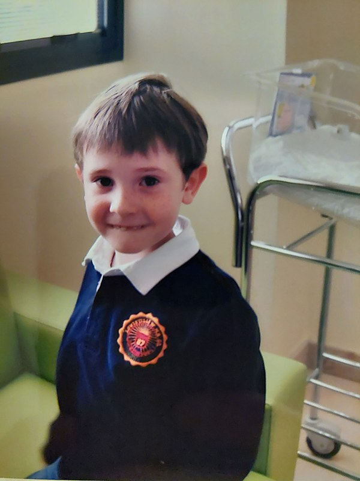

# Xabier Ariznabarreta

  

<em>
AI Engineering student in Madrid, turning from shipping production systems toward research. 
Over the last year and a half I've built production systems: LLM agents over Salesforce taking real traffic, institutional department tooling in real use, a university booking platform built to spec and pending rollout, and a local-first desktop stats app. 
The bugs were the teacher. The bottleneck isn't the engineering, it's the science underneath. 
So I'm working my way in from the applied side, with merged fixes to the eval infrastructure behind frontier-model safety and the lessons written down in public. 
Builder in the concrete, learner in the deep.
</em>

<b><a href="https://xabier.me">xabier.me →</a></b>

---

## Merged contributions

Small fixes, real repos — the eval infrastructure behind frontier-model safety research.

- **[METR/hawk #627](https://github.com/METR/hawk/pull/627)** — [METR](https://github.com/METR) (Model Evaluation & Threat Research). Auth fix in `hawk`, their cloud Inspect-AI eval runner: a passthrough credential header containing only whitespace is now treated as missing (`401` + `anonymous`) instead of surfacing an unactionable `"invalid api key"`. *Merged.*
- **[princeton-pli/hal-harness #182](https://github.com/princeton-pli/hal-harness/pull/182)** — [HAL](https://github.com/princeton-pli), the Holistic Agent Leaderboard (Princeton PLI). Resolved a `wandb`/`weave`/`gql` version conflict that broke every agent-env container at startup; aligned the three runners, the Docker image, packaging, and contributor docs. *Merged.*
- **[affaan-m/ECC #920](https://github.com/affaan-m/ECC/pull/920)** — [everything-claude-code](https://github.com/affaan-m/ECC), the most-starred agent toolkit on GitHub. Contributed the Token Budget Advisor skill. *Merged.*

---

## Production work

Real systems built for clients and institutions, some live and taking traffic, some built to spec and pending rollout. Code is private; writeups on the architecture and the lessons are landing on [xabier.me](https://xabier.me).

<table>
  <tr>
    <td width="50%" valign="top">
      <b>SAM — production LLM agent</b> 
      Commercial + field-ops orchestrator built for a Spanish firm that maintains the exteriors of 2,500+ buildings. A declarative profile-pipeline over Salesforce + Vertex AI / Gemini — adding a new agent is one declarative entry, no core changes. Serves Salesforce Apex (sync) and an Android app (SSE streaming). FastAPI · Cloud Run. 
      
    </td>
    <td width="50%" valign="top">
      <b>LinceReservations</b> 
      A study-room booking platform I built for a private university in Madrid, designed to their institutional requirements and pending adoption (not yet deployed). Five languages, institutional SSO (Azure AD / MSAL), row-level security, calendar sync. React 19 · TypeScript · Supabase. 
      
    </td>
  </tr>
  <tr>
    <td width="50%" valign="top">
      <b>Numo</b> 
      A local-first desktop statistics app — a real stats engine (pandas / scipy / statsmodels) bundled with the app, plus natural-language interpretation. Your data never leaves your machine; only the interpretation layer talks to a model. Tauri v2. 
      
    </td>
    <td width="50%" valign="top">
      <b>Institutional tooling</b> 
      Evaluation and automation tools built for a university department — project-review interfaces used by ~30–40 professors a year, room-booking automation, an annual reporting pipeline. Production institutional software, not proofs of concept. 
      
    </td>
  </tr>
</table>

---

## Open Source

<table>
  <tr>
    <td width="50%" valign="top">
      <a href="https://github.com/Xabilimon1/reeljet"><b>reeljet</b></a> 
      AI short-form video ad generator, as a Claude Code skill 
       
      
      
    </td>
    <td width="50%" valign="top">
      <a href="https://github.com/Xabilimon1/TBA-Token-Budget-Advisor-Claude-Code"><b>TBA — Token Budget Advisor</b></a> 
      Depth/cost choice before Claude answers · merged into <a href="https://github.com/affaan-m/ECC/pull/920">ECC</a> 
       
      
      
    </td>
  </tr>
  <tr>
    <td width="50%" valign="top">
      <a href="https://github.com/Xabilimon1/xabier-blog"><b>xabier-blog</b></a> 
      Personal research notebook · Astro · <a href="https://xabier.me">xabier.me</a> 
       
      
      
    </td>
    <td width="50%" valign="top">
      <a href="https://github.com/Xabilimon1/save-session"><b>save-session</b></a> 
      Claude Code skill — compressed session summaries to a vault 
       
      
      
    </td>
  </tr>
</table>

Also early / idea-stage: <a href="https://github.com/Xabilimon1/harness-ablation">harness-ablation</a> (an agent-harness ablation study I sketched out) · <a href="https://github.com/Xabilimon1/xabier-arena-solutions">xabier-arena-solutions</a> (placeholder for the ARENA curriculum, starting soon).

---

## Currently

- **Writing up** the production lessons as case studies on [xabier.me](https://xabier.me): SAM's agent architecture and the LinceReservations build first.
- **Contributing** to eval-framework open source — more PRs in the pipeline after the three above.
- **Next** — the [ARENA](https://www.arena.education/) alignment curriculum, to build the research foundations under the applied experience.

---

## Highlights

| Highlight | Detail |
|---|---|
| **Merged eval-infra fixes** | 3 PRs into [METR/hawk](https://github.com/METR/hawk/pull/627), [Princeton HAL](https://github.com/princeton-pli/hal-harness/pull/182), and [ECC](https://github.com/affaan-m/ECC/pull/920) — the eval stack behind frontier-model safety research |
| **Production work** | LLM agents over Salesforce taking real traffic, department tooling for ~30–40 professors in real use, a university booking platform built to spec (pending adoption), a local-first desktop stats app |
| **Open source** | [reeljet](https://github.com/Xabilimon1/reeljet), [TBA](https://github.com/Xabilimon1/TBA-Token-Budget-Advisor-Claude-Code) (merged into ECC), [save-session](https://github.com/Xabilimon1/save-session), and [this blog](https://xabier.me) |
| **Writing in public** | [xabier.me](https://xabier.me) — a research notebook, bilingual (ES/EN) |
| **Studying** | 2nd-year AI Systems Engineering at [UFV](https://www.ufv.es), Madrid |

---

**Focus** — agent evals · Inspect-AI · production LLM systems &nbsp;·&nbsp; **Stack** — Python · TypeScript · FastAPI · React · Astro

---

  
  
  

---

  <a href="https://xabier.me">Blog</a> ·
  <a href="https://github.com/Xabilimon1">GitHub</a> ·
  <a href="mailto:xabier.ariznabarreta@gmail.com">Email</a> ·
  <a href="https://xabier.me/rss.xml">RSS</a>

